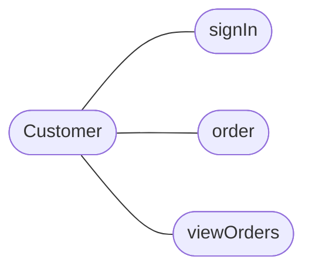
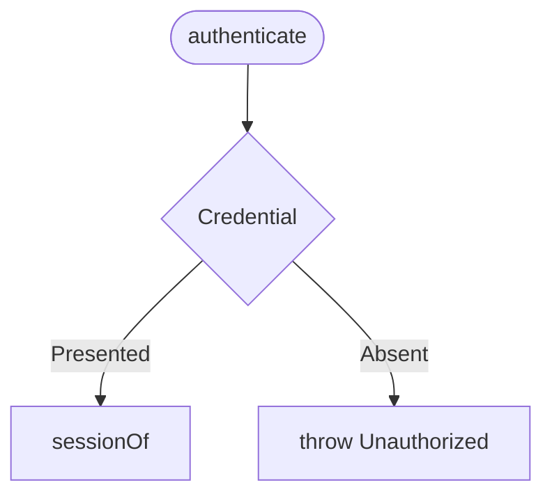
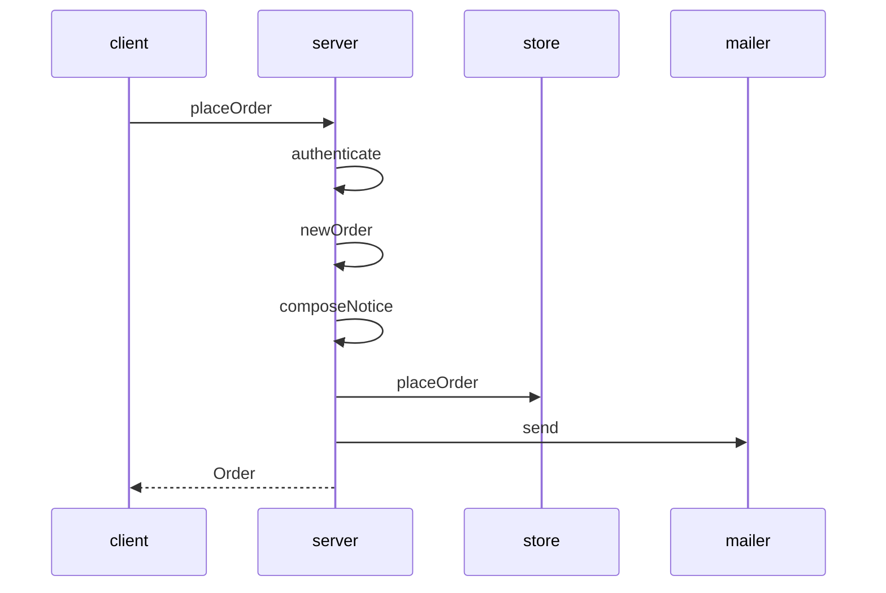
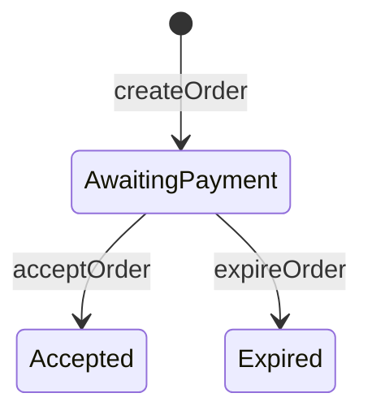
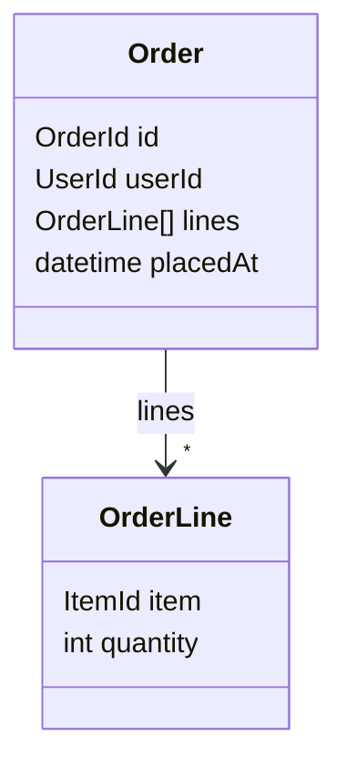
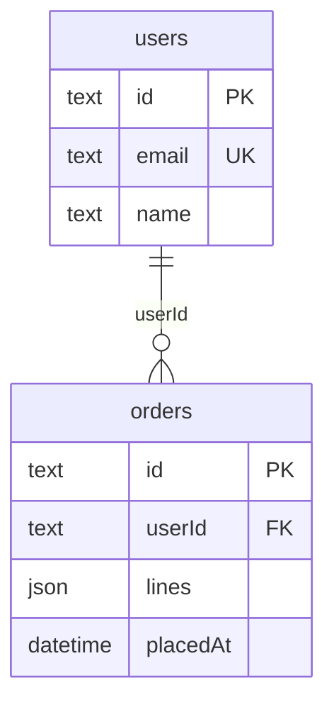
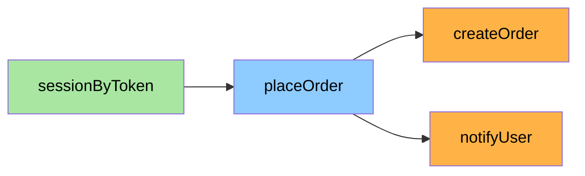
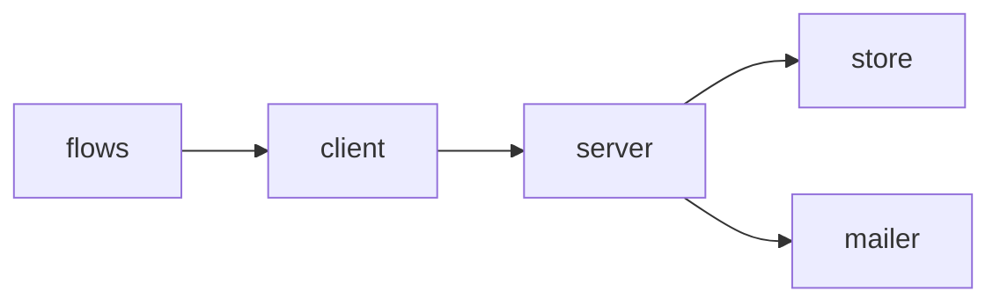
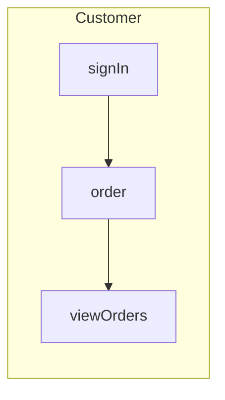

# Hozo

[English](README.md) | 日本語

## 名前

**Hozo** は、枘（ほぞ）。木の部材の端に作る突起で、もう一つの部材の穴に、はまる。ほぞ接ぎは、木の中身を合わせない。合わせるのは、二つの部材が、合わさる所の形だけで、それで、部材は組み上がる。

Hozo は、同じことを、ソフトウェアの設計にする。中身は、書かない。決めるのは、部品と部品が、合わさる所の形だけ: 何を受け取り、何を返すか。何を読み書きするか。何を、どの順に呼ぶか。

その形が、設計で、Hozo は、それを、**ただ一つの正（SSOT）**として持つ言語。コードの大半を、AI が書くようになっても、設計は、人が持ち続ける。Hozo は、設計を、人が、レビューして、手直しできる形で、持つ。

## 設計の手法を、コードで書く

設計の手法で描くものは、その形の、一つの見え方。Hozo では、どの見え方も、一つの言語で、一つの仕様に書く。手法を開くと、図と、同じことを言う Hozo が、出る。

**UML**

<details>
<summary>ユースケース図</summary>

担い手は、分類のケース。ユースケースは、担い手を名指しする関数。



```
classify Actor of never {
  @prd.actor.human Customer;
}

@prd.usecase.of(design.Actor.Customer)
export fn order(token: type.Token, lines: type.OrderLine[]): type.Order {
  return server.placeOrder({ token: token, lines: lines });
}
```

[`tests/samples/shop-server/design.hozo`](tests/samples/shop-server/design.hozo), [`tests/samples/shop-server/client.hozo`](tests/samples/shop-server/client.hozo) からの、省いた抜き書き。まだ書けない: 広げる（extend）。

</details>

<details>
<summary>アクティビティ図、決定表</summary>

分かれ道は、分類での `match`。仕様が言うのは、どの場合に、何をするか。どうやって、その場合だと分かるかは、言わない。



```
classify Credential of type.Token? {
  Presented: type.Token? as type.Token;
  Absent:    type.Token? as else;
}

fn authenticate(token: type.Token?): type.Session {
  return match (token by Credential) {
    Presented => sessionOf(token);
    Absent    => throw type.Unauthorized;
  }
}
```

[`tests/samples/shop-server/server.hozo`](tests/samples/shop-server/server.hozo) からの、省いた抜き書き。配線で書けるものは、ほかに: 並行（`disjoint`）と、繰り返し（`for`）。

</details>

<details>
<summary>シーケンス図</summary>

帯は、名前空間。メッセージは、配線の呼び出しで、書いた順に並ぶ。



```
@http.post("/orders")
export fn placeOrder(in: PlaceOrderInput): type.Order {
  val session = authenticate(in.token);
  val order = newOrder(session, in.lines);
  val notice = composeNotice(order);
  store.placeOrder(order, notice);
  mailer.send(notice);
  return order;
}
```

[`tests/samples/shop-server/server.hozo`](tests/samples/shop-server/server.hozo) からの、省いた抜き書き。まだ書けない: 複合フラグメント。

</details>

<details>
<summary>ステートマシン図、状態遷移表</summary>

状態は、分類のケース。遷移は、それを起こす効果が、宣言する: どのケースから（`on`）、どのケースへ（`as`）。



```
classify Standing of Order {
  AwaitingPayment;
  Accepted;
  Expired;
}

effect fn createOrder(order: Order): effects orders.post as Standing.AwaitingPayment;
effect fn acceptOrder(order: Order on Standing.AwaitingPayment, at: datetime): effects orders.put as Standing.Accepted;
effect fn expireOrder(order: Order on Standing.AwaitingPayment, at: datetime): effects orders.put as Standing.Expired;
```

[`tests/samples/order-app/domain/ordering.hozo`](tests/samples/order-app/domain/ordering.hozo) からの、省いた抜き書き。まだ書けない: ガード、入れ子の状態、履歴。

</details>

<details>
<summary>クラス図</summary>

クラスは、`model`。属性は、フィールド。関連は、フィールドの型。制約は、デコレータ。



```
model OrderLine {
  item: ItemId;
  @valid.min(1) quantity: int;
}

model Order {
  id: OrderId;
  userId: UserId;
  lines: OrderLine[];
  placedAt: datetime;
}
```

[`tests/samples/shop-server/type.hozo`](tests/samples/shop-server/type.hozo) からの、省いた抜き書き。まだ書けない: 操作、汎化、集約とコンポジションの区別。

</details>

**データと API**

<details>
<summary>ER 図、テーブル定義</summary>

表は、`state`。列、キー、参照は、`model` のフィールドの、デコレータ。



```
model User {
  @db.key    @db.text id: UserId;
  @db.unique @db.text email: Email;
  @db.text @valid.length(min: 1, max: 100) name: string;
}

model Order {
  @db.key       @db.text id: OrderId;
  @db.ref(User) @db.text userId: UserId;
  @db.json lines: OrderLine[];
  @db.datetime placedAt: datetime;
}

@db.table
state users: list<type.User>;

@db.table
state orders: list<type.Order>;
```

[`tests/samples/shop-server/type.hozo`](tests/samples/shop-server/type.hozo), [`tests/samples/shop-server/store.hozo`](tests/samples/shop-server/store.hozo) からの、省いた抜き書き。

</details>

<details>
<summary>API の設計</summary>

経路は、関数のデコレータ。入力を、要求のどこから読むかは、フィールドのデコレータ。

```
model PlaceOrderInput {
  @http.header("Authorization") token: type.Token?;
  @http.required @http.body lines: type.OrderLine[];
}

@http.post("/orders")
export fn placeOrder(in: PlaceOrderInput): type.Order { … }
```

[`tests/samples/shop-server/server.hozo`](tests/samples/shop-server/server.hozo) からの、省いた抜き書き。

</details>

**要求、ドメイン、アーキテクチャ**

<details>
<summary>ユーザーストーリー、受け入れ条件、トレーサビリティ</summary>

要求は、名前を持つケース。設計の側が、応える要求を指すので、どこからも指されていない要求は、穴。ストーリーは、ユースケースと、その担い手。受け入れ条件は、書かなければならないテスト: どのテストが要るかは、仕様が決め、走ったことは、`hozoc` が確かめる。

```
classify Requirement of never {
  /** ログインしていない人は、注文できない */
  PRD_001;
  /** 注文したら、その注文が、自分の注文の一覧に出る */
  PRD_002;
}

@prd.ref(design.Requirement.PRD_001)
fn authenticate(token: type.Token?): type.Session { … }

@prd.ref(design.Requirement.PRD_001, design.Requirement.PRD_002)
export fn placeOrder(in: PlaceOrderInput): type.Order { … }
```

[`tests/samples/shop-server/design.hozo`](tests/samples/shop-server/design.hozo), [`tests/samples/shop-server/server.hozo`](tests/samples/shop-server/server.hozo) からの、省いた抜き書き。まだ書けない: 値についての条件。

</details>

<details>
<summary>イベントストーミング</summary>

コマンドは、関数。事実（イベント）は、効果。読むモデルは、`read`。集約は、状態を持つ名前空間: その外からは、状態を、読み書きできない。



```
namespace store {
  state orders: list<type.Order>;

  read fn sessionByToken(token: type.Token): type.Session? reads sessions;
  effect fn createOrder(order: type.Order): effects orders.post;
  effect fn notifyUser(notification: type.Notification): effects notifications.post;
}
```

[`tests/samples/shop-server/store.hozo`](tests/samples/shop-server/store.hozo) からの、省いた抜き書き。図に出ないもの: 方針。仕様では、配線の順。

</details>

<details>
<summary>C4 モデル、コンポーネント図</summary>

部品は、名前空間。口は、外に出した（`export`）関数。依る向きは、名前空間をまたぐ呼び出し。



```
namespace client {
  export fn order(token: type.Token, lines: type.OrderLine[]): type.Order {
    return server.placeOrder({ token: token, lines: lines });
  }
}

namespace server {
  export fn placeOrder(in: PlaceOrderInput): type.Order { … }
}
```

[`tests/samples/shop-server/client.hozo`](tests/samples/shop-server/client.hozo), [`tests/samples/shop-server/server.hozo`](tests/samples/shop-server/server.hozo) からの、省いた抜き書き。まだ書けない: こちらと、外の境。

</details>

<details>
<summary>業務フロー図、サービスブループリント</summary>

フローは、ユースケースを、順に呼ぶ配線を持つ関数。E2E テストが、求められる所になる。



```
@prd.business.flow
export fn signInAndOrder(email: type.Email, password: type.Password, lines: type.OrderLine[]): Ordered {
  val token = client.signIn(email, password);
  val placed = client.order(token, lines);
  val listed = client.viewOrders(token);
  return { placed: placed, listed: listed };
}
```

[`tests/samples/shop-server/flows.hozo`](tests/samples/shop-server/flows.hozo) からの、省いた抜き書き。まだ書けない: ステップの間の、分かれ道、待つこと、補償。

</details>

<details>
<summary>決定の記録（ADR）</summary>

決定は、名前を持つケース。背景と、採らなかった案は、コメントの中のタグ。宣言の側が、それを形作った決定を指す。Hozo は、自分の決定を、この形で、記録している。

```
/**
 * 説明のコメントの中に、タグとして書けるのは、注記だけ。
 *
 * @adr.context そうしないと、振る舞いを決めるデコレータが、コメントの中から、本当に、付く。
 * @adr.rejected 今のまま
 */
@adr.amends(Decision.D478)
D480;
```

[`decisions.hozo`](decisions.hozo) からの、省いた抜き書き。

</details>

上の図は、このページのために、手で描いたもの: 仕様から図を描く UI は、まだ、ない。部品ごとの、対応の全体は、[`docs/ide-chain.md`](docs/ide-chain.md)「対応」。

## 書いた設計が、何になるか

`hozoc` が、仕様を検査して、コードの枠と、テストのハーネスにする。

- 配線は、コードとして、生成される。
- 中身のない関数は、人か AI が書く。実装が欠けていれば、生成したコードは、コンパイルできない。
- 仕様が求めるテストは、仕様から決まり、それが走ったことを、`hozoc` が確かめる。

最初の出力先の言語は、Go。仕様と、そのコードの一組は、[`tests/samples/shop-server`](tests/samples/shop-server)。

## 状態

Hozo は、未公開で、版は 0.x。版から版への互換は、まだ、何もない。

- **あるもの**: コンパイラ `hozoc`、言語サーバー、VS Code 拡張、Go のプラグイン。
- **まだ、ないもの**: 設計を、描いて、レビューして、手直しする UI。Go のほかの言語への出力。ライセンス。

## 次に読むもの

| したいこと | 読む場所 |
|---|---|
| 何のための言語かを知る | [`docs/requirements.md`](docs/requirements.md)「価値と位置づけ」 |
| 仕様を書く | [`docs/grammar.md`](docs/grammar.md)、[`docs/requirements.md`](docs/requirements.md)「書き方の指針」 |
| `hozoc` を動かす | [`docs/cli.md`](docs/cli.md)。`make build` で、`bin/` にできる（Go 1.24.7 以上） |
| プラグインを書く | [`docs/plugin-protocol.md`](docs/plugin-protocol.md) |
| Hozo 自身を直す | [`CLAUDE.md`](CLAUDE.md)、続けて [`docs/README.md`](docs/README.md) |

文書は、今は、日本語。処理系の第一言語である、英語に、移す。
