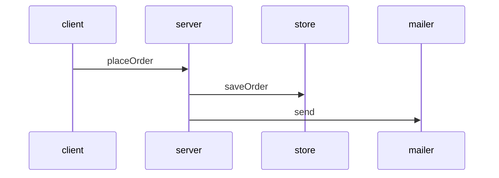
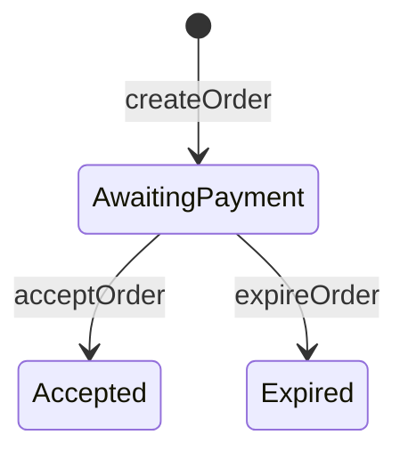
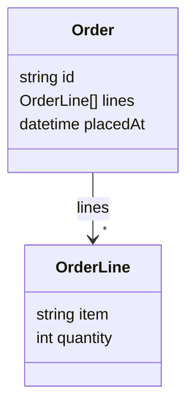
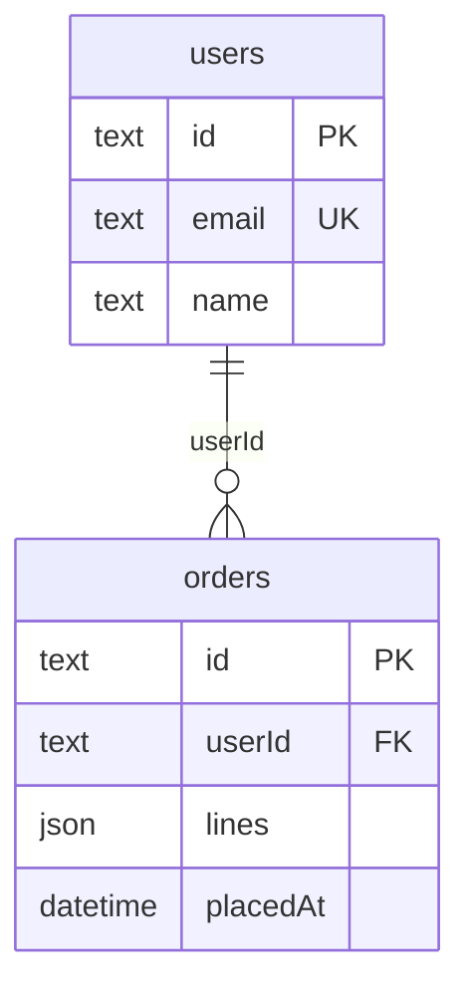
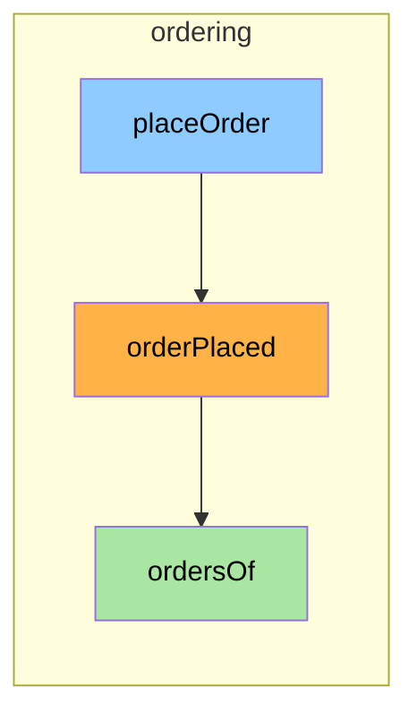
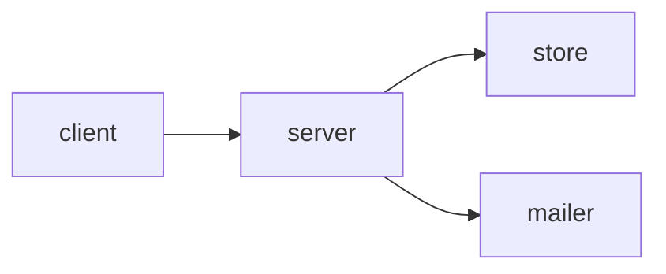
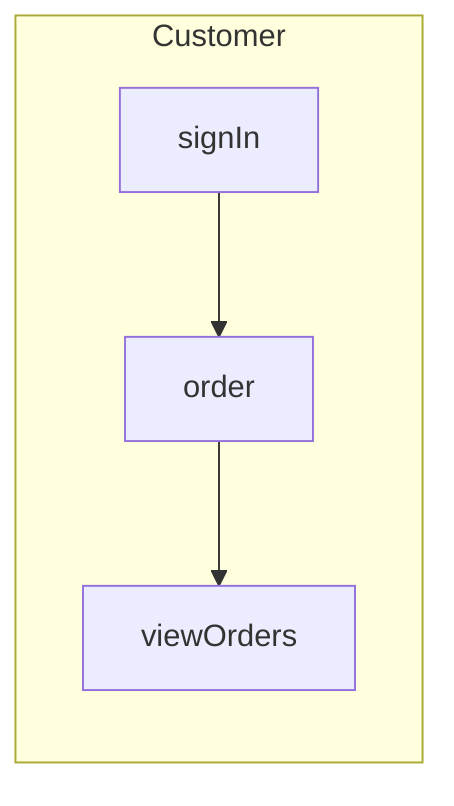

# Hozo

[English](README.md) | 日本語

## 名前

**Hozo** は、枘（ほぞ）。木の部材の端に作る突起で、もう一つの部材の穴に、はまる。ほぞ接ぎは、木の中身を合わせない。合わせるのは、二つの部材が、合わさる所の形だけで、それで、部材は組み上がる。

Hozo は、同じことを、ソフトウェアの設計にする。中身は、書かない。決めるのは、部品と部品が、合わさる所の形だけ: 何を受け取り、何を返すか。何を読み書きするか。何を、どの順に呼ぶか。その形が、設計。

## 価値

**Hozo は、アプリの設計の、ただ一つの正（SSOT）になる。**

これは、Hozo が、v1 のリリースまでに、提供するもの。Hozo は、未公開で、今あるものは、「状態」に書く。

1. **設計を、AI が書いても、人が、レビューして、手直しできる。** 設計は、図（次の節の、見え方）で見せ、人は、そこで、レビューして、手直しする。
2. **レビューした設計が、そのまま、コードの枠と、テストのハーネスになる。** 呼ぶ順は、コードとして、生成される。人か AI が書くものは、埋める口になり、実装が欠けていれば、コンパイルできない。設計が求めるテストは、設計から決まり、作れるものは、生成され、走ったことが、確かめられる。
3. **人が、何に責任を持つかが、はっきりする。** 人が責任を持つのは、仕様。中身は、AI に任せられ、ハーネスが、中身を、仕様に留める。
4. **設計の手法ごとに、どれだけ効くかが、見える。** 設計の部品は、それぞれ、ある強さのハーネスになる: 生成されるコード、求められるテスト、型、または、注記だけ。その強さを、図ごとに示すので、設計が、何を縛っていないかが、見える。

## 設計の手法を、コードで書く

設計の手法で描くものは、その形の、一つの見え方。Hozo では、どの見え方も、一つの言語で、一つの仕様に書く。手法を開くと、図と、その図が言っていることを書いた Hozo が、出る。

**UML**

<details>
<summary>ユースケース図</summary>

担い手は、分類のケース。ユースケースは、担い手を名指しする関数。


```
classify Actor of never {
  @prd.actor.human Customer;
}

@prd.usecase.of(Actor.Customer)
export fn signIn();

@prd.usecase.of(Actor.Customer)
export fn order();

@prd.usecase.of(Actor.Customer)
export fn viewOrders();
```

**得られるもの**: ユースケースは、一つずつ、コードの関数になる。担い手は、注記で、何も縛らない。

</details>

<details>
<summary>アクティビティ図、決定表</summary>

分かれ道は、分類での `match`: どの場合に、何をするか。


```
fn authenticate(token: Token?): Session {
  return match (token by Credential) {
    Presented => sessionOf(token);
    Absent    => throw Unauthorized;
  }
}
```

**得られるもの**: 分かれ道は、コードとして、生成される。どのアームも受けないケースがあれば、仕様の error。

配線で書けるものは、ほかに: 並行（`disjoint`）と、繰り返し（`for`）。

</details>

<details>
<summary>シーケンス図</summary>

帯は、名前空間。メッセージは、呼び出しで、書いた順に並ぶ。



```
namespace client {
  export fn order() {
    server.placeOrder();
  }
}

namespace server {
  export fn placeOrder() {
    store.saveOrder();
    mailer.send();
  }
}

namespace store {
  export fn saveOrder();
}

namespace mailer {
  export fn send();
}
```

**得られるもの**: 呼び出しは、この順で、コードとして、生成される。外に出していない関数は、ほかの名前空間から、呼べない。

</details>

<details>
<summary>ステートマシン図、状態遷移表</summary>

状態は、分類のケース。遷移は、それを起こす効果が、宣言する: どのケースから（`on`）、どのケースへ（`as`）。



```
classify Standing of Order {
  AwaitingPayment;
  Accepted;
  Expired;
}

effect fn createOrder(order: Order): effects orders.post as Standing.AwaitingPayment;
effect fn acceptOrder(order: Order on Standing.AwaitingPayment): effects orders.put as Standing.Accepted;
effect fn expireOrder(order: Order on Standing.AwaitingPayment): effects orders.put as Standing.Expired;
```

**得られるもの**: 効果は、`on` のケースにあると分かっている行にしか、呼べない: ほかは、仕様の error。中身が、行を、宣言した向きにだけ動かすことは、テストが確かめる。

</details>

<details>
<summary>クラス図</summary>

クラスは、`model`。属性は、フィールド。関連は、フィールドの型。



```
model Order {
  id: string;
  lines: OrderLine[];
  placedAt: datetime;
}

model OrderLine {
  item: string;
  quantity: int;
}
```

**得られるもの**: model は、コードの型になる。

</details>

**データと API**

<details>
<summary>ER 図、テーブル定義</summary>

表は、`state`。列、キー、参照は、`model` のフィールドの、デコレータ。



```
model User {
  @db.key    @db.text id: string;
  @db.unique @db.text email: string;
  @db.text name: string;
}

model Order {
  @db.key       @db.text id: string;
  @db.ref(User) @db.text userId: string;
  @db.json lines: string[];
  @db.datetime placedAt: datetime;
}

@db.table
state users: list<User>;

@db.table
state orders: list<Order>;
```

**得られるもの**: 表の定義が、生成される（SQLite）。`read` と効果に `@db.*` を付ければ、表を読み書きするコードも、生成される。

</details>

<details>
<summary>API の設計</summary>

経路は、関数のデコレータ。入力を、要求のどこから読むかは、フィールドのデコレータ。

| Method | Path | Header | Body | Response |
|---|---|---|---|---|
| `POST` | `/orders` | `Authorization` | `lines` (required) | `Order` |

```
model PlaceOrderInput {
  @http.header("Authorization") token: string?;
  @http.required @http.body lines: OrderLine[];
}

@http.post("/orders")
export fn placeOrder(in: PlaceOrderInput): Order;
```

**得られるもの**: HTTP のハンドラが、生成される。

</details>

**要求、ドメイン、アーキテクチャ**

<details>
<summary>ユーザーストーリー、要求のトレーサビリティ</summary>

要求は、名前を持つケースで、文は、コメント。設計の側が、応える要求を指すので、どこからも指されていない要求は、穴。

| 要求 | `authenticate` | `placeOrder` |
|---|---|---|
| `PRD_001` ログインしていない人は、注文できない | ✓ | ✓ |
| `PRD_002` 注文したら、その注文が、自分の注文の一覧に出る | | ✓ |

```
classify Requirement of never {
  /** ログインしていない人は、注文できない */
  PRD_001;
  /** 注文したら、その注文が、自分の注文の一覧に出る */
  PRD_002;
}

@prd.ref(Requirement.PRD_001)
fn authenticate();

@prd.ref(Requirement.PRD_001, Requirement.PRD_002)
export fn placeOrder();
```

**得られるもの**: 要求ごとに、テストの入れ物ができ、求めるテストが走ったことを、`hozoc` が確かめる。上の表は、仕様から描かれ、どこからも指されていない要求を、見せる。

</details>

<details>
<summary>イベントストーミング</summary>

コマンドは、関数。事実（イベント）は、効果。読むモデルは、`read`。集約は、状態を持つ名前空間。



```
namespace ordering {
  state orders: list<Order>;

  export fn placeOrder(order: Order) {
    orderPlaced(order);
  }

  effect fn orderPlaced(order: Order): effects orders.post;

  read fn ordersOf(userId: string): Order[] reads orders;
}
```

**得られるもの**: コマンドは、配線から、生成される。事実と、読むモデルは、埋める口で、`@db.*` を付ければ、生成される。状態は、その名前空間の中でしか、読み書きできない: ほかは、error。

図に出ないもの: 方針。仕様では、呼ぶ順。

</details>

<details>
<summary>C4 モデル、コンポーネント図</summary>

部品は、名前空間。口は、外に出した（`export`）関数。依る向きは、名前空間をまたぐ呼び出し。シーケンス図と、同じ仕様: その、別の見え方。



```
namespace client {
  export fn order() {
    server.placeOrder();
  }
}

namespace server {
  export fn placeOrder() {
    store.saveOrder();
    mailer.send();
  }
}

namespace store {
  export fn saveOrder();
}

namespace mailer {
  export fn send();
}
```

**得られるもの**: 名前空間をまたぐ呼び出しが、生成される。外に出していない関数を呼ぶこと、ほかの名前空間の状態に触れることは、error。

</details>

<details>
<summary>業務フロー図、サービスブループリント</summary>

フローは、ユースケースを、順に呼ぶ関数。レーンは、そのユースケースの、担い手。



```
@prd.business.flow
export fn signInAndOrder() {
  client.signIn();
  client.order();
  client.viewOrders();
}
```

**得られるもの**: フローに、E2E テストが、求められる。ステップを呼ぶ所は、生成され、ケースは、人か AI が書く。

</details>

<details>
<summary>決定の記録（ADR）</summary>

決定は、名前を持つケース。背景と、採らなかった案は、コメントの中のタグ。ほかの決定との関係は、デコレータ。

> **480. コメントの中に、タグとして書けるのは、注記だけ**
>
> 直す決定: 478
>
> 背景: そうしないと、振る舞いを決めるデコレータが、コメントの中から、本当に、付く。
>
> 採らなかった案: 今のまま。

```
/**
 * コメントの中に、タグとして書けるのは、注記だけ。
 *
 * @adr.context そうしないと、振る舞いを決めるデコレータが、コメントの中から、本当に、付く。
 * @adr.rejected 今のまま。
 */
@adr.amends(Decision.D478)
D480;
```

**得られるもの**: 注記で、何も縛らない。宣言の裏にある決定は、その宣言と一緒に、見せる。

</details>

図は、このページのために、手で描いたもの。Hozo では、仕様から、描かれる。

## 状態

Hozo は、未公開で、版は 0.x。版から版への互換は、まだ、何もない。

- **あるもの**: コンパイラ `hozoc`、言語サーバー、VS Code 拡張、Go のプラグイン。
- **まだ、ないもの**: 設計を、描いて、レビューして、手直しする UI。Go のほかの言語への出力。ライセンス。

## ドキュメント

ドキュメントは、v1 のリリースまでに、ページとして、用意する。それまでは、案内できるものが、ない。
