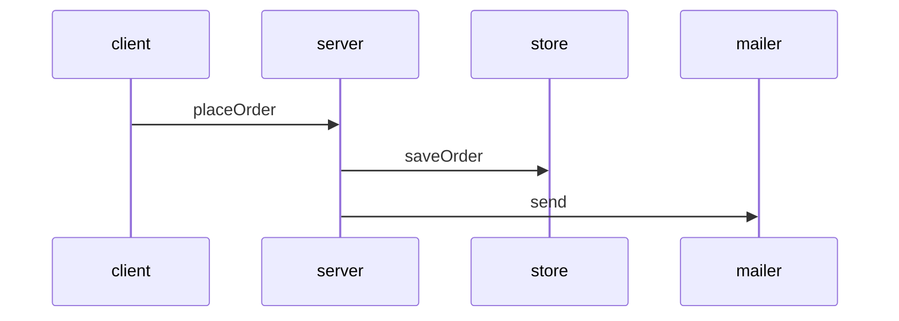
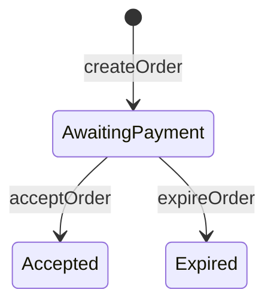
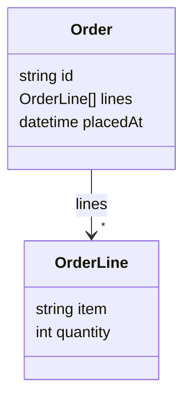
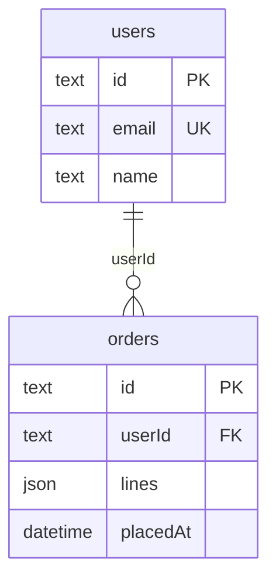
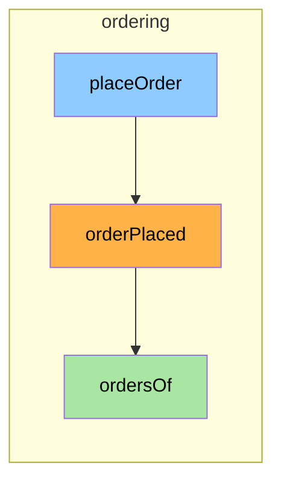
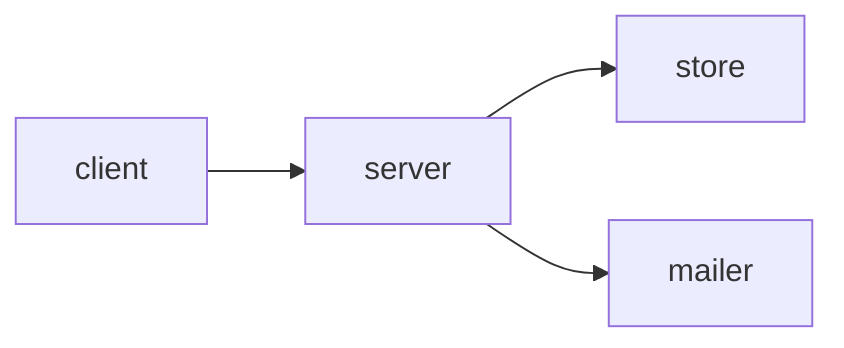
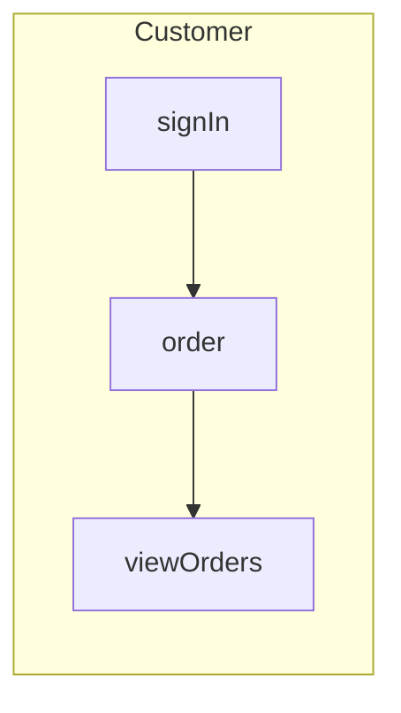

# Hozo

English | [日本語](README.ja.md)

## The name

**Hozo** (枘) is the Japanese word for a tenon: the tongue cut on the end of a piece of wood, which fits into a hole in another piece. A joiner who builds with tenons does not match the insides of the wood. Only the shapes where two pieces meet have to match, and the pieces hold together.

Hozo does the same to the design of software. You do not write the insides. You decide only the shapes where the parts meet: what each part takes and returns, what it reads and writes, and what it calls in which order. Those shapes are the design.

## The value

**Hozo is the single source of truth for an application's design.**

Parts of this are not built yet. They are marked *(planned)*.

1. **People can review and correct the design, even when an AI wrote it.**
   - Today: the design is text in one language. A compiler checks it, and a language server and a VS Code extension help to read and write it.
   - *(Planned)* A UI that shows the design as diagrams, the views in the next section, where people review and correct it.
2. **The reviewed design becomes the skeleton of the code and its test harness, as it is.**
   - Today: `hozoc` generates the wiring as code. A function without a body is a slot that a person or an AI fills, and a missing implementation does not compile. The tests that the specification requires are determined from it, and `hozoc` checks that they ran. The target language is Go.
   - *(Planned)* Tests that are generated from the specification itself. Target languages other than Go.
3. **It is clear what people are responsible for.** People are responsible for the specification. The bodies can be left to an AI, and the harness holds them to the specification.
4. **You can see how much each design method buys.** A part of a design gives a harness of some strength: generated code, required tests, a type, or nothing but an annotation.
   - Today: each method in the next section says what you get from it.
   - *(Planned)* The strength shown as a number for each diagram, so that you can see what a design leaves unguarded.

## Design methods, written as code

What you draw with a design method is one view of those shapes. In Hozo, every view is written in one language, in one specification. Open a method to see a diagram, and the Hozo that says what the diagram says.

**UML**

<details>
<summary>Use case diagram</summary>

An actor is a case of a classification. A use case is a function that names its actor.


```
classify Actor of never {
  @prd.actor.human Customer;
}

@prd.usecase.of(Actor.Customer)
export fn signIn();

@prd.usecase.of(Actor.Customer)
export fn order();

@prd.usecase.of(Actor.Customer)
export fn viewOrders();
```

**You get**: Each use case becomes a function in the code. The actor is an annotation: it constrains nothing.

Not yet: extend.

</details>

<details>
<summary>Activity diagram, decision table</summary>

A branch is a `match` over a classification: in which case, what happens.


```
fn authenticate(token: Token?): Session {
  return match (token by Credential) {
    Presented => sessionOf(token);
    Absent    => throw Unauthorized;
  }
}
```

**You get**: The branch is generated as code. A case that no arm takes is an error in the specification.

Also written as wiring: parallel steps (`disjoint`) and loops (`for`).

</details>

<details>
<summary>Sequence diagram</summary>

A lifeline is a namespace. A message is a call, in the order written.



```
namespace client {
  export fn order() {
    server.placeOrder();
  }
}

namespace server {
  export fn placeOrder() {
    store.saveOrder();
    mailer.send();
  }
}

namespace store {
  export fn saveOrder();
}

namespace mailer {
  export fn send();
}
```

**You get**: The calls are generated as code, in this order. A function that is not exported cannot be called from another namespace.

Not yet: combined fragments.

</details>

<details>
<summary>State machine diagram, state transition table</summary>

A state is a case of a classification. A transition is declared by the effect that makes it: from which case (`on`), to which case (`as`).



```
classify Standing of Order {
  AwaitingPayment;
  Accepted;
  Expired;
}

effect fn createOrder(order: Order): effects orders.post as Standing.AwaitingPayment;
effect fn acceptOrder(order: Order on Standing.AwaitingPayment): effects orders.put as Standing.Accepted;
effect fn expireOrder(order: Order on Standing.AwaitingPayment): effects orders.put as Standing.Expired;
```

**You get**: An effect can be called only on a row that is known to be in its `on` case: anything else is an error in the specification. *(Planned)* A test that the body moves the row only in the declared direction.

Not yet: guards, nested states, history.

</details>

<details>
<summary>Class diagram</summary>

A class is a `model`. An attribute is a field, and an association is the type of a field.



```
model Order {
  id: string;
  lines: OrderLine[];
  placedAt: datetime;
}

model OrderLine {
  item: string;
  quantity: int;
}
```

**You get**: The models become types in the code.

Not yet: operations, generalization, the difference between aggregation and composition.

</details>

**Data and API**

<details>
<summary>ER diagram, table definition</summary>

A table is a `state`. Its columns, keys and references are decorators on the fields of the `model`.



```
model User {
  @db.key    @db.text id: string;
  @db.unique @db.text email: string;
  @db.text name: string;
}

model Order {
  @db.key       @db.text id: string;
  @db.ref(User) @db.text userId: string;
  @db.json lines: string[];
  @db.datetime placedAt: datetime;
}

@db.table
state users: list<User>;

@db.table
state orders: list<Order>;
```

**You get**: The table definitions are generated (SQLite). With `@db.*` on a `read` or an effect, the code that reads and writes the table is generated as well.

</details>

<details>
<summary>API design</summary>

A route is a decorator on a function. Where each input is read from is a decorator on a field.

| Method | Path | Header | Body | Response |
|---|---|---|---|---|
| `POST` | `/orders` | `Authorization` | `lines` (required) | `Order` |

```
model PlaceOrderInput {
  @http.header("Authorization") token: string?;
  @http.required @http.body lines: OrderLine[];
}

@http.post("/orders")
export fn placeOrder(in: PlaceOrderInput): Order;
```

**You get**: The HTTP handler is generated.

</details>

**Requirements, domain and architecture**

<details>
<summary>User stories, requirements traceability</summary>

A requirement is a named case, and its text is the comment. The design points at the requirements it serves, so a requirement that nothing points at is a hole.

| Requirement | `authenticate` | `placeOrder` |
|---|---|---|
| `PRD_001` A person who is not signed in cannot place an order | ✓ | ✓ |
| `PRD_002` After an order is placed, it appears in the list of my orders | | ✓ |

```
classify Requirement of never {
  /** A person who is not signed in cannot place an order */
  PRD_001;
  /** After an order is placed, it appears in the list of my orders */
  PRD_002;
}

@prd.ref(Requirement.PRD_001)
fn authenticate();

@prd.ref(Requirement.PRD_001, Requirement.PRD_002)
export fn placeOrder();
```

**You get**: Each requirement gets a slot for its tests, and `hozoc` checks that the required tests ran. *(Planned)* The matrix above, drawn from the specification, with the requirements that nothing points at.

Not yet: acceptance criteria as conditions on values.

</details>

<details>
<summary>Event Storming</summary>

A command is a function. An event is an effect. A read model is a `read`. An aggregate is the namespace that owns the state.



```
namespace ordering {
  state orders: list<Order>;

  export fn placeOrder(order: Order) {
    orderPlaced(order);
  }

  effect fn orderPlaced(order: Order): effects orders.post;

  read fn ordersOf(userId: string): Order[] reads orders;
}
```

**You get**: The command is generated from its wiring. The event and the read model are slots to fill, or generated when they carry `@db.*`. The state can be read and written only inside its namespace: anything else is an error.

Not shown: policies. In the specification, they are the order of the calls.

</details>

<details>
<summary>C4 model, component diagram</summary>

A component is a namespace. Its interface is what it exports, and a dependency is a call across namespaces. This is the same specification as in the sequence diagram: another view of it.



```
namespace client {
  export fn order() {
    server.placeOrder();
  }
}

namespace server {
  export fn placeOrder() {
    store.saveOrder();
    mailer.send();
  }
}

namespace store {
  export fn saveOrder();
}

namespace mailer {
  export fn send();
}
```

**You get**: The calls across namespaces are generated. Calling what a namespace does not export, or reaching into its state, is an error.

Not yet: the boundary between the system and the outside.

</details>

<details>
<summary>Business flow, service blueprint</summary>

A flow is a function that calls the use cases in order. A lane is the actor of those use cases.



```
@prd.business.flow
export fn signInAndOrder() {
  client.signIn();
  client.order();
  client.viewOrders();
}
```

**You get**: An end-to-end test is required for the flow. The part that calls the steps is generated, and you supply the cases.

Not yet: branches, waits and compensation between the steps.

</details>

<details>
<summary>Architecture decision records (ADR)</summary>

A decision is a named case. Its context and its rejected options are tags in the comment, and its relation to another decision is a decorator.

> **480. Only an annotation can be written as a tag inside a comment**
>
> Amends: 478
>
> Context: Otherwise a decorator that decides behaviour would take effect from inside a comment.
>
> Rejected: Leave it as it is.

```
/**
 * Only an annotation can be written as a tag inside a comment.
 *
 * @adr.context Otherwise a decorator that decides behaviour would take effect from inside a comment.
 * @adr.rejected Leave it as it is.
 */
@adr.amends(Decision.D478)
D480;
```

**You get**: An annotation: it constrains nothing. *(Planned)* The decisions behind a declaration, shown in the UI.

</details>

The diagrams are drawn by hand for this page. *(Planned)* The UI draws them from the specification. The correspondence, part by part, is in [`docs/ide-chain.md`](docs/ide-chain.md), "対応".

## Status

Hozo is unreleased and at version 0.x. Nothing is compatible from one version to the next yet.

- **Exists**: the compiler `hozoc`, the language server, the VS Code extension, and the plugins for Go.
- **Does not exist yet**: the UI for drawing, reviewing and correcting a design. Target languages other than Go. A license.

## Read next

| You want to | Read |
|---|---|
| Know what the language is for | [`docs/requirements.md`](docs/requirements.md), "価値と位置づけ" |
| Write a specification | [`docs/grammar.md`](docs/grammar.md), and [`docs/requirements.md`](docs/requirements.md), "書き方の指針" |
| Run `hozoc` | [`docs/cli.md`](docs/cli.md). `make build` builds it into `bin/`, with Go 1.24.7 or later |
| Write a plugin | [`docs/plugin-protocol.md`](docs/plugin-protocol.md) |
| Work on Hozo itself | [`CLAUDE.md`](CLAUDE.md), then [`docs/README.md`](docs/README.md) |

The documents are in Japanese for now. They will move to English, the first language of the toolchain.
