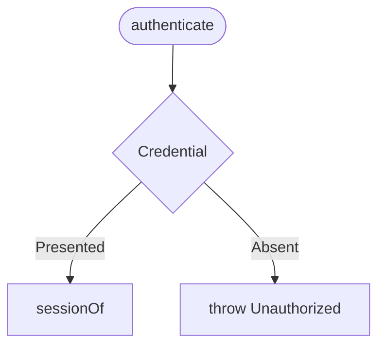
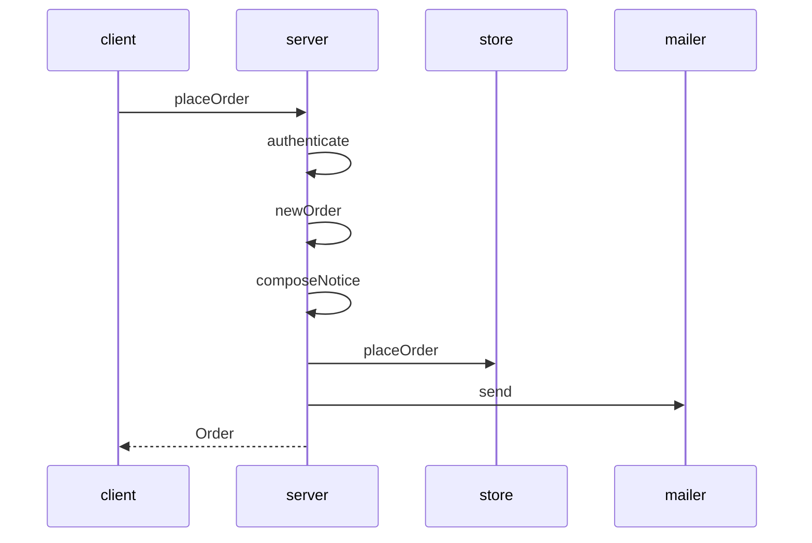
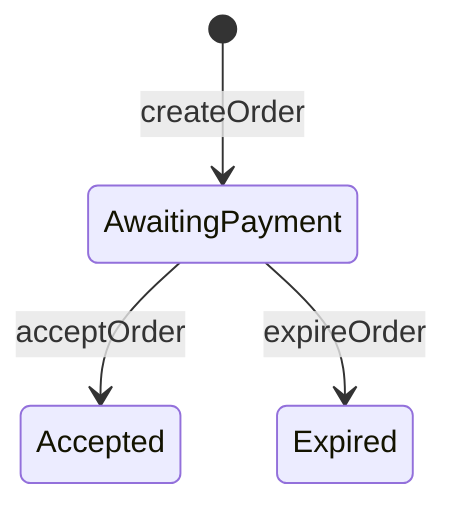
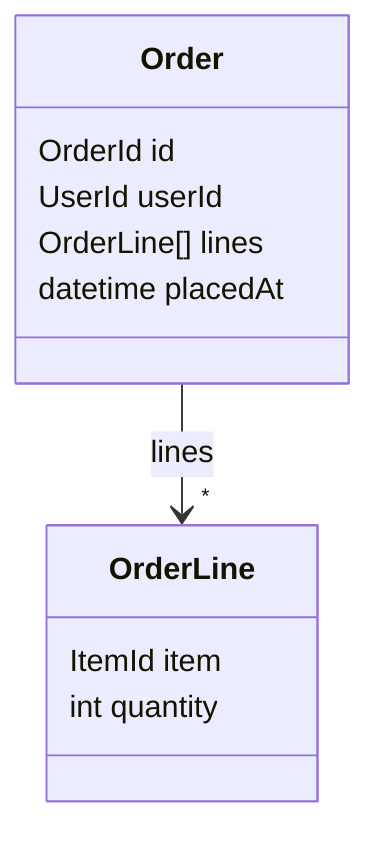
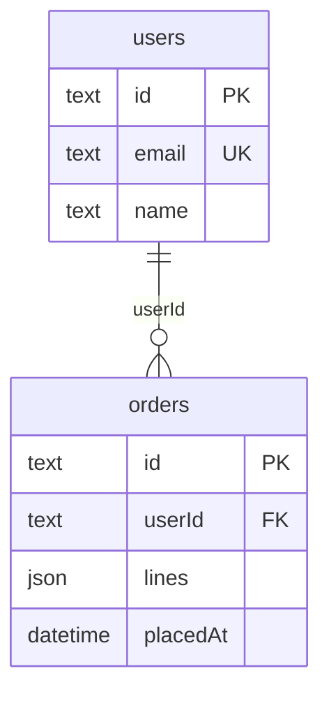
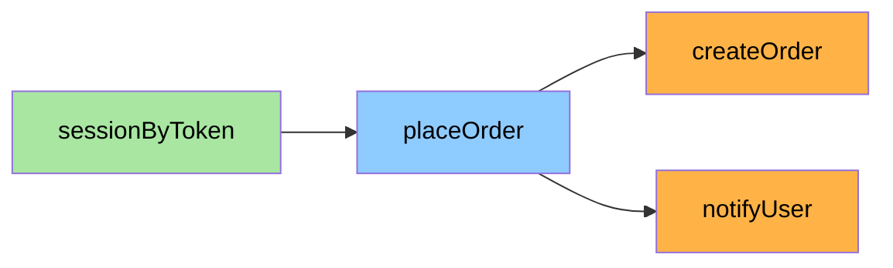
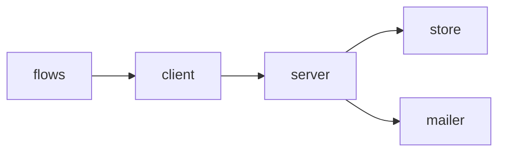
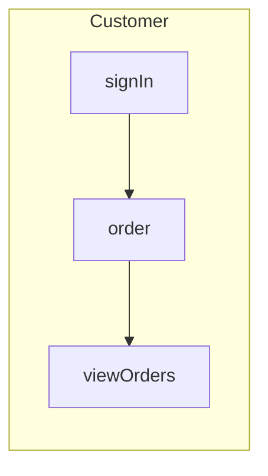

# Hozo

English | [日本語](README.ja.md)

## The name

**Hozo** (枘) is the Japanese word for a tenon: the tongue cut on the end of a piece of wood, which fits into a hole in another piece. A joiner who builds with tenons does not match the insides of the wood. Only the shapes where two pieces meet have to match, and the pieces hold together.

Hozo does the same to the design of software. You do not write the insides. You decide only the shapes where the parts meet: what each part takes and returns, what it reads and writes, and what it calls in which order.

Those shapes are the design, and Hozo is the language that holds them as **the single source of truth**. When an AI writes most of the code, the design is what people still have to own. Hozo keeps it in a form that people can review and correct.

## Design methods, written as code

What you draw with a design method is one view of those shapes. In Hozo, every view is written in one language, in one specification. Open a method to see its diagram and the Hozo that says the same thing.

**UML**

<details>
<summary>Use case diagram</summary>

An actor is a case of a classification. A use case is a function that names its actor.


```
classify Actor of never {
  @prd.actor.human Customer;
}

@prd.usecase.of(design.Actor.Customer)
export fn order(token: type.Token, lines: type.OrderLine[]): type.Order {
  return server.placeOrder({ token: token, lines: lines });
}
```

From [`tests/samples/shop-server/design.hozo`](tests/samples/shop-server/design.hozo), [`tests/samples/shop-server/client.hozo`](tests/samples/shop-server/client.hozo), abridged. Not yet: extend.

</details>

<details>
<summary>Activity diagram, decision table</summary>

A branch is a `match` over a classification. The specification says what happens in each case, and not how the case is told.



```
classify Credential of type.Token? {
  Presented: type.Token? as type.Token;
  Absent:    type.Token? as else;
}

fn authenticate(token: type.Token?): type.Session {
  return match (token by Credential) {
    Presented => sessionOf(token);
    Absent    => throw type.Unauthorized;
  }
}
```

From [`tests/samples/shop-server/server.hozo`](tests/samples/shop-server/server.hozo), abridged. Also written as wiring: parallel steps (`disjoint`) and loops (`for`).

</details>

<details>
<summary>Sequence diagram</summary>

A lifeline is a namespace. A message is a call in the wiring, in the order written.



```
@http.post("/orders")
export fn placeOrder(in: PlaceOrderInput): type.Order {
  val session = authenticate(in.token);
  val order = newOrder(session, in.lines);
  val notice = composeNotice(order);
  store.placeOrder(order, notice);
  mailer.send(notice);
  return order;
}
```

From [`tests/samples/shop-server/server.hozo`](tests/samples/shop-server/server.hozo), abridged. Not yet: combined fragments.

</details>

<details>
<summary>State machine diagram, state transition table</summary>

A state is a case of a classification. A transition is declared by the effect that makes it: from which case (`on`), to which case (`as`).



```
classify Standing of Order {
  AwaitingPayment;
  Accepted;
  Expired;
}

effect fn createOrder(order: Order): effects orders.post as Standing.AwaitingPayment;
effect fn acceptOrder(order: Order on Standing.AwaitingPayment, at: datetime): effects orders.put as Standing.Accepted;
effect fn expireOrder(order: Order on Standing.AwaitingPayment, at: datetime): effects orders.put as Standing.Expired;
```

From [`tests/samples/order-app/domain/ordering.hozo`](tests/samples/order-app/domain/ordering.hozo), abridged. Not yet: guards, nested states, history.

</details>

<details>
<summary>Class diagram</summary>

A class is a `model`. An attribute is a field, an association is the type of a field, and a constraint is a decorator.



```
model OrderLine {
  item: ItemId;
  @valid.min(1) quantity: int;
}

model Order {
  id: OrderId;
  userId: UserId;
  lines: OrderLine[];
  placedAt: datetime;
}
```

From [`tests/samples/shop-server/type.hozo`](tests/samples/shop-server/type.hozo), abridged. Not yet: operations, generalization, the difference between aggregation and composition.

</details>

**Data and API**

<details>
<summary>ER diagram, table definition</summary>

A table is a `state`. Its columns, keys and references are decorators on the fields of the `model`.



```
model User {
  @db.key    @db.text id: UserId;
  @db.unique @db.text email: Email;
  @db.text @valid.length(min: 1, max: 100) name: string;
}

model Order {
  @db.key       @db.text id: OrderId;
  @db.ref(User) @db.text userId: UserId;
  @db.json lines: OrderLine[];
  @db.datetime placedAt: datetime;
}

@db.table
state users: list<type.User>;

@db.table
state orders: list<type.Order>;
```

From [`tests/samples/shop-server/type.hozo`](tests/samples/shop-server/type.hozo), [`tests/samples/shop-server/store.hozo`](tests/samples/shop-server/store.hozo), abridged.

</details>

<details>
<summary>API design</summary>

A route is a decorator on a function. Where each input comes from is a decorator on a field.

```
model PlaceOrderInput {
  @http.header("Authorization") token: type.Token?;
  @http.required @http.body lines: type.OrderLine[];
}

@http.post("/orders")
export fn placeOrder(in: PlaceOrderInput): type.Order { … }
```

From [`tests/samples/shop-server/server.hozo`](tests/samples/shop-server/server.hozo), abridged.

</details>

**Requirements, domain and architecture**

<details>
<summary>User stories, acceptance criteria, traceability</summary>

A requirement is a named case. The design points at the requirements it serves, so a requirement that nothing points at is a hole. A story is a use case and its actor. An acceptance criterion is a test that has to be written: the specification decides which tests are required, and `hozoc` checks that they ran.

```
classify Requirement of never {
  /** A person who is not signed in cannot place an order */
  PRD_001;
  /** After an order is placed, it appears in the list of my orders */
  PRD_002;
}

@prd.ref(design.Requirement.PRD_001)
fn authenticate(token: type.Token?): type.Session { … }

@prd.ref(design.Requirement.PRD_001, design.Requirement.PRD_002)
export fn placeOrder(in: PlaceOrderInput): type.Order { … }
```

From [`tests/samples/shop-server/design.hozo`](tests/samples/shop-server/design.hozo), [`tests/samples/shop-server/server.hozo`](tests/samples/shop-server/server.hozo), abridged. Not yet: conditions on values.

</details>

<details>
<summary>Event Storming</summary>

A command is a function. An event is an effect. A read model is a `read`. An aggregate is the namespace that owns the state: nothing outside it can read or write that state.



```
namespace store {
  state orders: list<type.Order>;

  read fn sessionByToken(token: type.Token): type.Session? reads sessions;
  effect fn createOrder(order: type.Order): effects orders.post;
  effect fn notifyUser(notification: type.Notification): effects notifications.post;
}
```

From [`tests/samples/shop-server/store.hozo`](tests/samples/shop-server/store.hozo), abridged. Not shown: policies. In the specification, they are the order of the wiring.

</details>

<details>
<summary>C4 model, component diagram</summary>

A component is a namespace. Its interface is what it exports, and a dependency is a call across namespaces.



```
namespace client {
  export fn order(token: type.Token, lines: type.OrderLine[]): type.Order {
    return server.placeOrder({ token: token, lines: lines });
  }
}

namespace server {
  export fn placeOrder(in: PlaceOrderInput): type.Order { … }
}
```

From [`tests/samples/shop-server/client.hozo`](tests/samples/shop-server/client.hozo), [`tests/samples/shop-server/server.hozo`](tests/samples/shop-server/server.hozo), abridged. Not yet: the boundary between the system and the outside.

</details>

<details>
<summary>Business flow, service blueprint</summary>

A flow is a function whose wiring calls the use cases in order. It becomes the place where an end-to-end test is required.



```
@prd.business.flow
export fn signInAndOrder(email: type.Email, password: type.Password, lines: type.OrderLine[]): Ordered {
  val token = client.signIn(email, password);
  val placed = client.order(token, lines);
  val listed = client.viewOrders(token);
  return { placed: placed, listed: listed };
}
```

From [`tests/samples/shop-server/flows.hozo`](tests/samples/shop-server/flows.hozo), abridged. Not yet: branches, waits and compensation between the steps.

</details>

<details>
<summary>Architecture decision records (ADR)</summary>

A decision is a named case, with its context and its rejected options as tags in the comment. A declaration points at the decisions that shaped it. Hozo records its own decisions this way.

```
/**
 * Only an annotation can be written as a tag inside a comment.
 *
 * @adr.context Otherwise a decorator that decides behaviour would take effect from inside a comment.
 * @adr.rejected Leave it as it is
 */
@adr.amends(Decision.D478)
D480;
```

From [`decisions.hozo`](decisions.hozo), abridged.

</details>

The diagrams above are drawn by hand for this page: the UI that draws them from a specification does not exist yet. The full correspondence, part by part, is in [`docs/ide-chain.md`](docs/ide-chain.md), "対応".

## What the design becomes

`hozoc` checks the specification, and turns it into the skeleton of the code and its test harness.

- The wiring is generated as code.
- A function without a body is left to a person or an AI. If its implementation is missing, the generated code does not compile.
- The tests that the specification requires are determined from it, and `hozoc` checks that they ran.

The first target language is Go. A pair of a specification and its code is in [`tests/samples/shop-server`](tests/samples/shop-server).

## Status

Hozo is unreleased and at version 0.x. Nothing is compatible from one version to the next yet.

- **Exists**: the compiler `hozoc`, the language server, the VS Code extension, and the plugins for Go.
- **Does not exist yet**: the UI for drawing, reviewing and correcting a design. Target languages other than Go. A license.

## Read next

| You want to | Read |
|---|---|
| Know what the language is for | [`docs/requirements.md`](docs/requirements.md), "価値と位置づけ" |
| Write a specification | [`docs/grammar.md`](docs/grammar.md), and [`docs/requirements.md`](docs/requirements.md), "書き方の指針" |
| Run `hozoc` | [`docs/cli.md`](docs/cli.md). `make build` builds it into `bin/`, with Go 1.24.7 or later |
| Write a plugin | [`docs/plugin-protocol.md`](docs/plugin-protocol.md) |
| Work on Hozo itself | [`CLAUDE.md`](CLAUDE.md), then [`docs/README.md`](docs/README.md) |

The documents are in Japanese for now. They will move to English, the first language of the toolchain.
