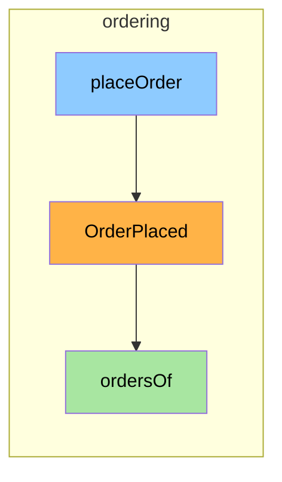
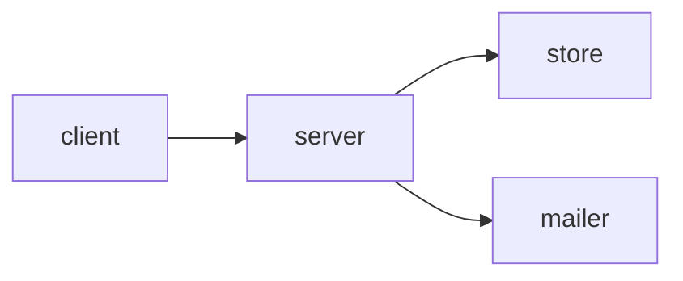
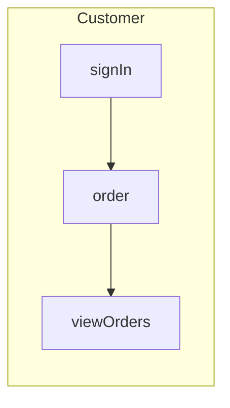
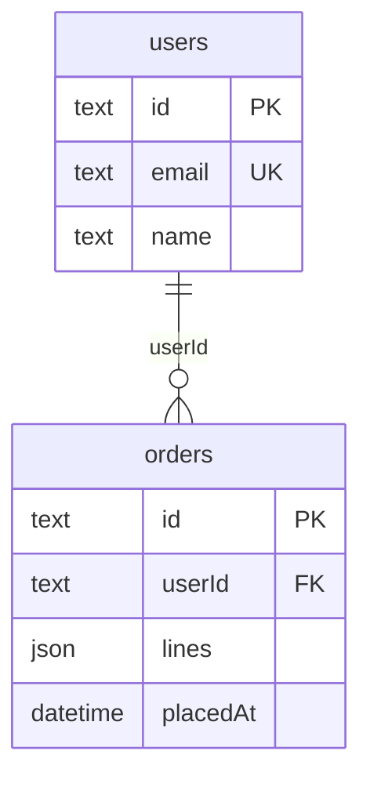
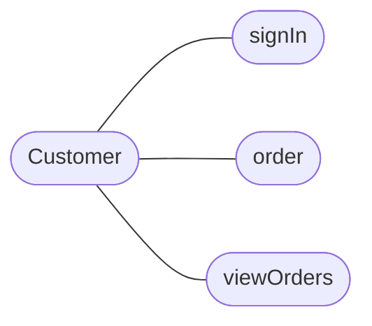
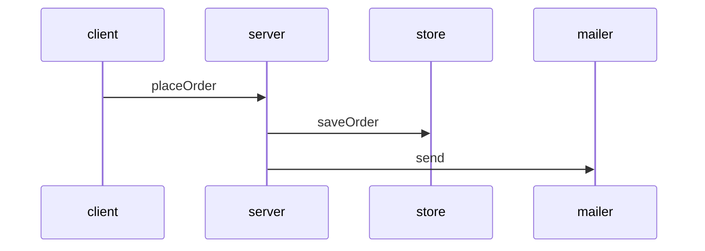
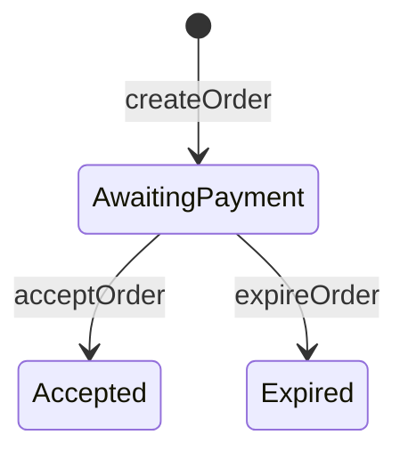
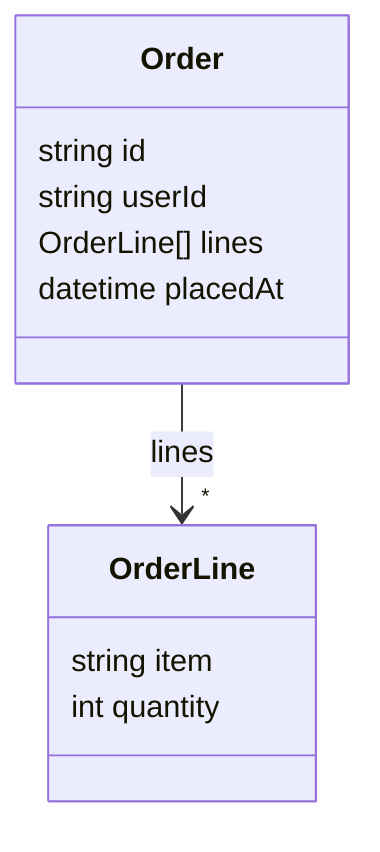

# Hozo

English | [日本語](README.ja.md)

## The name

**Hozo** (枘, pronounced *HOH-zoh*, /hozo/) is the Japanese word for a tenon: the tongue cut on the end of a piece of wood, which fits into a hole in another piece. A joiner who builds with tenons does not match the insides of the wood. Only the shapes where two pieces meet have to match, and the pieces hold together.

Hozo does the same to the design of software. You do not write the insides. You decide only the shapes where the parts meet: what each part takes and returns, what it reads and writes, and what it calls in which order. Those shapes are the design.

## The value

**Hozo is the single source of truth for an application's design.**

This is what Hozo provides by its v1 release. Hozo is unreleased, and what exists today is under "Status".

1. **People can review and correct the design, even when an AI wrote it.** The design is shown as diagrams, the views in the next section, and people review and correct it there.
2. **The reviewed design becomes the skeleton of the code and its test harness, as it is.** The order of the calls is generated as code. What a person or an AI has to write is a slot, and a missing implementation does not compile. The tests that the design requires are determined from it, generated where they can be, and checked to have run.
3. **It is clear what people are responsible for.** People are responsible for the specification. The bodies can be left to an AI, and the harness holds them to the specification.
4. **You can see how much each design method buys.** A part of a design gives a harness of some strength: generated code, required tests, a type, or nothing but an annotation. The strength is shown for each diagram, so that you can see what a design leaves unguarded.

## From design methods to Hozo

What you draw with a design method is one view of those shapes. In Hozo, every view is written in one language, in one specification. Open a method to see a diagram, and the Hozo that says what the diagram says. Each piece shows only what the diagram shows: the declarations it leans on are left out.

You design with the methods that suit your work, and the same specification is shown as the other views too: a design made with one method can be previewed in another. Most UML diagrams (sequence, class, component) are such previews, drawn from the specification. The ones a manager designs with, such as the use case diagram, can be edited.

**Requirements, domain and architecture**

<details>
<summary>User stories, requirements traceability</summary>

A requirement is a named case, and its text is the comment. The design points at the requirements it serves, so a requirement that nothing points at is a hole.

| Requirement | `authenticate` | `placeOrder` |
|---|---|---|
| `PRD_001` A person who is not signed in cannot place an order | ✓ | ✓ |
| `PRD_002` After an order is placed, it appears in the list of my orders | | ✓ |

```
classify Requirement of never {
  /** A person who is not signed in cannot place an order */
  PRD_001;
  /** After an order is placed, it appears in the list of my orders */
  PRD_002;
}

@prd.ref(Requirement.PRD_001)
fn authenticate();

@prd.ref(Requirement.PRD_001, Requirement.PRD_002)
export fn placeOrder();
```

**You get**: Each requirement gets a slot for its tests, and `hozoc` checks that the required tests ran. The matrix above is drawn from the specification, and shows the requirements that nothing points at.

</details>

<details>
<summary>Event Storming</summary>

A command is a function. An event is an effect: the function is named for what it does, and the decorator names what has happened. A read model is a `read`. An aggregate is the namespace that owns the state.



```
namespace ordering {
  state orders: list<Order>;

  export fn placeOrder(order: Order) {
    createOrder(order);
  }

  @prd.eventstorming.event("OrderPlaced")
  effect fn createOrder(order: Order): effects orders.post;

  read fn ordersOf(userId: string): Order[] reads orders;
}
```

**You get**: The command is generated from its wiring. The event and the read model are slots to fill, or generated when they carry `@db.*`. The state can be read and written only inside its namespace: anything else is an error.

Not shown: policies. In the specification, they are the order of the calls.

</details>

<details>
<summary>C4 model, component diagram</summary>

A component is a namespace. Its interface is what it exports, and a dependency is a call across namespaces. This is the same specification as in the sequence diagram: another view of it.



```
namespace client {
  export fn order() {
    server.placeOrder();
  }
}

namespace server {
  export fn placeOrder() {
    store.saveOrder();
    mailer.send();
  }
}

namespace store {
  export fn saveOrder();
}

namespace mailer {
  export fn send();
}
```

**You get**: The calls across namespaces are generated. Calling what a namespace does not export, or reaching into its state, is an error.

</details>

<details>
<summary>Business flow, service blueprint</summary>

A flow is a function that calls the use cases in order. A lane is the actor of those use cases.



```
@prd.business.flow
export fn signInAndOrder() {
  client.signIn();
  client.order();
  client.viewOrders();
}
```

**You get**: An end-to-end test is required for the flow. The part that calls the steps is generated, and you supply the cases.

</details>

<details>
<summary>Architecture decision records (ADR)</summary>

A decision is a named case. Its context and its rejected options are tags in the comment, and its status and its relation to another decision are decorators.

> **480. Only an annotation can be written as a tag inside a comment**
>
> Status: Accepted
>
> Amends: 478
>
> Context: Otherwise a decorator that decides behaviour would take effect from inside a comment.
>
> Rejected: Leave it as it is.

```
/**
 * Only an annotation can be written as a tag inside a comment.
 *
 * @adr.context Otherwise a decorator that decides behaviour would take effect from inside a comment.
 * @adr.alternative Leave it as it is.
 */
@adr.accepted
@adr.amends(Decision400.D478)
D480;
```

**You get**: An annotation: it constrains nothing. The decisions behind a declaration are shown with it.

</details>

**Data and API**

<details>
<summary>ER diagram, table definition</summary>

A table is a `state`. Its columns, keys and references are decorators on the fields of the `model`.



```
model User {
  @db.key    @db.text id: string;
  @db.unique @db.text email: string;
  @db.text name: string;
}

model Order {
  @db.key       @db.text id: string;
  @db.ref(User) @db.text userId: string;
  @db.json lines: OrderLine[];
  @db.datetime placedAt: datetime;
}

@db.table
state users: list<User>;

@db.table
state orders: list<Order>;
```

**You get**: The table definitions are generated (SQLite). With `@db.*` on a `read` or an effect, the code that reads and writes the table is generated as well.

</details>

<details>
<summary>API design</summary>

A route is a decorator on a function. Where each input is read from is a decorator on a field.

| Method | Path | Header | Body | Response |
|---|---|---|---|---|
| `POST` | `/orders` | `Authorization` | `lines` (required) | `Order` |

```
model PlaceOrderInput {
  @http.header("Authorization") token: string?;
  @http.required @http.body lines: OrderLine[];
}

@http.post("/orders")
export fn placeOrder(in: PlaceOrderInput): Order;
```

**You get**: The HTTP handler is generated.

</details>

**UML**

<details>
<summary>Use case diagram</summary>

An actor is a case of a classification. A use case is a function that names its actor.



```
classify Actor of never {
  @prd.actor.human Customer;
}

@prd.usecase.of(Actor.Customer)
export fn signIn();

@prd.usecase.of(Actor.Customer)
export fn order();

@prd.usecase.of(Actor.Customer)
export fn viewOrders();
```

**You get**: Each use case becomes a function in the code. The actor is an annotation: it constrains nothing.

</details>

<details>
<summary>Activity diagram, decision table</summary>

A branch is a `match` over a classification: in which case, what happens.


```
fn authenticate(token: Token?): Session {
  return match (token by Credential) {
    Presented => sessionOf(token);
    Absent    => throw Unauthorized;
  }
}
```

**You get**: The branch is generated as code. A case that no arm takes is an error in the specification.

Also written as wiring: parallel steps (`disjoint`) and loops (`for`).

</details>

<details>
<summary>Sequence diagram</summary>

A lifeline is a namespace. A message is a call, in the order written.



```
namespace client {
  export fn order() {
    server.placeOrder();
  }
}

namespace server {
  export fn placeOrder() {
    store.saveOrder();
    mailer.send();
  }
}

namespace store {
  export fn saveOrder();
}

namespace mailer {
  export fn send();
}
```

**You get**: The calls are generated as code, in this order. A function that is not exported cannot be called from another namespace.

</details>

<details>
<summary>State machine diagram, state transition table</summary>

A state is a case of a classification. A transition is declared by the effect that makes it: from which case (`on`), to which case (`as`).



```
classify Standing of Order {
  AwaitingPayment;
  Accepted;
  Expired;
}

effect fn createOrder(order: Order): effects orders.post as Standing.AwaitingPayment;
effect fn acceptOrder(order: Order on Standing.AwaitingPayment): effects orders.put as Standing.Accepted;
effect fn expireOrder(order: Order on Standing.AwaitingPayment): effects orders.put as Standing.Expired;
```

**You get**: An effect can be called only on a row that is known to be in its `on` case: anything else is an error in the specification. When the code runs, the effect checks at its entry that the row is in that case.

</details>

<details>
<summary>Class diagram</summary>

A class is a `model`. An attribute is a field, and an association is the type of a field.



```
model Order {
  id: string;
  userId: string;
  lines: OrderLine[];
  placedAt: datetime;
}

model OrderLine {
  item: string;
  quantity: int;
}
```

**You get**: The models become types in the code.

</details>

The diagrams are drawn by hand for this page. In Hozo, they are drawn from the specification.

## From Hozo to code

Open a piece to see the Hozo, and the code that is generated from it. The code is Go, the first target language, abridged.

**Flow**

<details>
<summary>Wiring → a function</summary>

The order of the calls and the branches are generated as they are written. How a case is told comes from the classification: here, by the type.

```
classify Credential of Token? {
  Presented: Token? as Token;
  Absent:    Token? as else;
}

export fn authenticate(token: Token?): Session {
  return match (token by Credential) {
    Presented => sessionOf(token);
    Absent    => throw Unauthorized;
  }
}
```

```go
func (o *ops) Authenticate(ctx context.Context, token *Token) (Session, error) {
	if token != nil {
		return o.SessionOf(ctx, *token)
	}
	return Session{}, Unauthorized{}
}
```

</details>

<details>
<summary>A function without a body → a slot to fill</summary>

What a person or an AI writes is one method of an interface. A value that lacks a method does not compile where it is passed to `New`.

```
fn sessionOf(token: Token): Session;
```

```go
type Leaves interface {
	SessionOf(ctx context.Context, token Token) (Session, error)
}

func New(leaves Leaves) Ops
```

</details>

**Data**

<details>
<summary>A model and its constraints → a type and its validation</summary>

A `model` becomes a type. A constraint becomes a check, with the path of the field that broke it.

```
model OrderLine {
  item: string;
  @valid.min(1) quantity: int;
}
```

```go
type OrderLine struct {
	Item     string `json:"item"`
	Quantity int64  `json:"quantity"`
}

func (m OrderLine) Validate() error {
	var violations []runtime.Violation
	if int64(m.Quantity) < 1 {
		violations = append(violations, runtime.Violation{Path: "quantity", Constraint: "min"})
	}
	if len(violations) == 0 {
		return nil
	}
	return &runtime.ValidationError{Violations: violations}
}
```

</details>

**Edges of the system**

<details>
<summary>`@http.*` → an HTTP handler</summary>

The route, where each input is read from, and what is required come from the decorators. The function itself stays free of HTTP.

```
model PlaceOrderInput {
  @http.header("Authorization") token: string?;
  @http.required @http.body lines: OrderLine[];
}

@http.post("/orders")
export fn placeOrder(in: PlaceOrderInput): Order;
```

```go
mux.HandleFunc("POST /orders", func(w http.ResponseWriter, r *http.Request) {
	var in PlaceOrderInput
	req := httpRequest{r: r}
	req.header("Authorization", &in.Token)
	req.body("lines", &in.Lines, httpRequired)
	if !req.ok(w) {
		return
	}
	out, err := ops.PlaceOrder(r.Context(), in)
	if err != nil {
		httpWriteError(w, err)
		return
	}
	httpWriteResult(w, out)
})
```

</details>

<details>
<summary>`@db.*` → a table, and the statements that read and write it</summary>

The state is a table. The effect is a statement on it. Nothing else in the specification mentions SQL.

```
model User {
  @db.key    @db.text id: string;
  @db.unique @db.text email: string;
  @db.text name: string;
}

@db.table
state users: list<User>;

@db.insert
effect fn createUser(user: User): effects users.post;
```

```go
const Schema = `CREATE TABLE IF NOT EXISTS "users" (
  "id" TEXT NOT NULL PRIMARY KEY,
  "email" TEXT NOT NULL UNIQUE,
  "name" TEXT NOT NULL
);
`

func (t UsersTable) CreateUser(ctx context.Context, user User) error {
	args, err := dbArgsUser(user)
	if err != nil {
		return err
	}
	return dbExec(ctx, t.db,
		`INSERT INTO "users" ("id", "email", "name") VALUES (?1, ?2, ?3)`, args...)
}
```

</details>

**Tests**

<details>
<summary>A function without a body → the test cases it needs</summary>

Each function that a person or an AI writes needs its cases. A value that lacks a case does not compile where it is passed to `RunLeaves`.

```
fn sessionOf(token: Token): Session;
```

```go
type SessionOfCases interface {
	OK() SessionOfCase
}

type SessionOfCase struct {
	Token auth.Token
	Then  func(t *testing.T, got auth.Session, err error)
}

type LeafCases interface {
	SessionOf() SessionOfCases
}

func RunLeaves(t *testing.T, leaves auth.Leaves, c LeafCases)
```

</details>

<details>
<summary>An entry → an integration test for each place an exception comes from</summary>

You supply the cases of the interface. The tests for the exceptions are generated: each one makes the place the exception comes from throw it, and checks what the entry answers.

```
@http.status(401)
exception Unauthorized;

@http.status(409)
exception OutOfStock;

@http.post("/orders")
export fn placeOrder(in: PlaceOrderInput): Order {
  val session = authenticate(in.token);
  return reserve(session, in.lines);
}

fn authenticate(token: string?): Session
  throws Unauthorized;

fn reserve(session: Session, lines: OrderLine[]): Order
  throws OutOfStock;
```

```go
type PlaceOrderHTTPCases interface {
	OK() PlaceOrderHTTPCase
	BadRequest() PlaceOrderHTTPCase
}

t.Run("Unauthorized", func(t *testing.T) {
	t.Run("api.authenticate", func(t *testing.T) {
		k := cases.OK()
		res, _ := send(t, k, func(f *Fakes) {
			f.Leaves.Authenticate.Throws(api.Unauthorized{})
		})
		httpWantThrown[api.Unauthorized](t, res, 401)
	})
})
t.Run("OutOfStock", func(t *testing.T) {
	t.Run("api.reserve", func(t *testing.T) {
		k := cases.OK()
		res, _ := send(t, k, func(f *Fakes) {
			f.Leaves.Reserve.Throws(api.OutOfStock{})
		})
		httpWantThrown[api.OutOfStock](t, res, 409)
	})
})
```

</details>

## Status

Hozo is unreleased and at version 0.x. Nothing is compatible from one version to the next yet.

- **Exists**: the compiler `hozoc`, the language server, the VS Code extension, and the plugins for Go.
- **Does not exist yet**: the UI for drawing, reviewing and correcting a design. Target languages other than Go. A license.

## Documentation

The documentation will be published as pages by the v1 release. Until then, there is none to point to.
